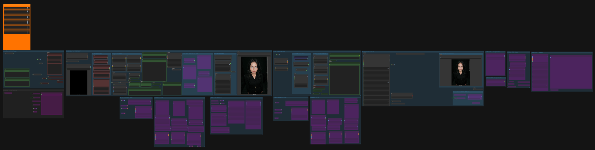

# Phase 04: Modular Multi-Model Inference & Video Pipeline (ComfyUI)

This final phase integrates trained LoRAs from Phase 03 into a unified, production-grade **ComfyUI** inference graph governed by **rgthree Fast Groups Bypasser** switches, alongside dedicated helper workflows for facial embedding pre-calculation and 15-second video synthesis.

All launch flags and memory profiles are calibrated for an **NVIDIA RTX 4090 (24GB VRAM)**.

---

---

## 1. Environment & Multi-Monitor Workspace Automation (`scripts/`)

* **`scripts/start_comfyui_rtx4090.example.bat`:** Initializes the **Visual Studio 2022 C++ Build Environment (`vcvarsall.bat amd64`)** prior to launching Python so **Triton / SageAttention** kernels compile cleanly on Windows, and starts ComfyUI with `--use-sage-attention --disable-smart-memory` to maximize 24GB VRAM retention without constant model offloading.
* **`scripts/workspace_launcher.py`:** Automates workstation startup across dual monitors using `pygetwindow` and `pyautogui`—launching ComfyUI, opening prompt templates, and positioning tabbed Windows File Explorer windows for datasets, LoRA outputs, and renders.

---

## 2. Master Multi-Model Workflow (`workflows/master_multi_model_pipeline.json`)

Instead of maintaining separate graphs per task, this workflow organizes **22 modular groups** controlled from a central **`rgthree` Fast Groups Bypasser** panel.

### Active Default Pipeline (Two-Stage Hybrid Generation)

1. **Stage 1 — Composition & Anatomy Base (`Pony Diffusion V6 XL`):**
   * **Input Mode Switch (`TXT2IMG` ↔ `IMG2IMG`):** A boolean `Switch IMAGE` toggles between `Empty Latent Image` and `Load Image` (with automatic resolution detection via `Get Image Size`) paired with an exposed `denoise` float node (`0.80` recommended for IMG2IMG).
   * **Modular 4-Block Prompt Concatenation:** Splits prompts into four structured text nodes (*1. Quality & Main Subject → 2. Outfit → 3. Action & Scene → 4. Secondary Subject / Manual Override*), controlled by a boolean `Switch CAPTION` to blend or override **WD14 Tagger** outputs.
   * **Sampler Config:** `cyberrealisticPony_v180_fp32_Coreshift.safetensors` (`CLIP Set Last Layer: -2`), `35 steps`, `CFG: 2.5`, `dpmpp_2m_sde` / `karras`, plus 4 LoRA slots.
   * **Initial Identity Lock (`ReActor`):** Loads pre-built `.safetensors` face models (`inswapper_128.onnx` + `retinaface_resnet50`) reinforced by `Face Booster` (`GPEN-BFR-512.onnx` + `CodeFormer`).

2. **Stage 2 — Photorealistic Texture & Identity Refinement (`FLUX.1-dev` + `PuLID-Flux`):**
   * **Model & LoRAs:** Feeds the Stage 1 render into `flux1CompactClipAND_Flux1DevFP16.safetensors` (`CLIP Last Layer: -1`) with 3 dedicated FLUX LoRA slots.
   * **Full-Frame SDXL IP-Adapter (`IP-ADAPTER PONY`):** Uses `PrepImageForClipVision` (`crop_position: pad`) so full-frame portraits load cleanly into `ip-adapter-plus_sdxl_vit-h` without center-cropping.
   * **Full-Frame Facial Conditioning (`PuLID-Flux`):** Replaces square-cropped CLIP Vision adapters with `pulid_flux_v0.9.1.safetensors` + `InsightFace (antelopev2)` + `EVA02-CLIP` (`weight: 0.75–0.85`, `end_at: 0.750`). Accepts full-frame reference portraits without center-cropping while preserving natural skin pores.
   * **Single-Pass Facial Refinement (`FaceDetailer`):** Uses `FaceDetailer` directly as the FLUX KSampler (`YOLOv8` + `SAM ViT-H` at `1024x1024`, `20 steps`, `CFG: 1.0`, `euler` / `normal`, `denoise: 0.30`), cutting total generation time to **~34 seconds total for both Pony + FLUX renders** on an RTX 4090.

### Compatibility Patch Note (Modern ComfyUI + PuLID-Flux)
* If ComfyUI throws `TypeError: pulid_forward_orig() got an unexpected keyword argument 'timestep_zero_index'`, open `custom_nodes/ComfyUI-PuLID-Flux/PulidFluxHook.py` and add `timestep_zero_index=None, **kwargs` to the `def pulid_forward_orig(...)` signature.

### Optional Plug-and-Play Support Modules (Bypassed by Default)
* **ControlNet Suites (`SDXL` & `FLUX`):** Pre-wired Canny, Depth, and OpenPose pipelines with live preprocessor previews (`CONTROLNET - SDXL 02 ADJUST`) ready to toggle on when strict pose locking is required.
* **Two-Stage Upscaler (`UPSCALER 2 - STAGE I & II`):** Can be fed directly from the `ADetailer` output or via a standalone image loader for high-resolution finishing.
* **Full Masked ReActor & Florence-2 Auto-Prompt:** Available in the `rgthree` panel for complex multi-subject masking or natural-language prompt generation.

---

## 3. Complementary Workflows (`workflows/`)

* **`workflows/reactor_face_model_builder.json`:** Batch-processes up to 12 reference portraits (8 active by default) through `Make Image Batch` and `Build Blended Face Model` (`compute_method: Mean`, `save_mode: ON`) to export reusable `.safetensors` facial models in seconds.
* **`workflows/wan22_flf2v_video_generator.json`:** Generates **15-second videos in ~10 minutes** on an RTX 4090 using dual **Wan 2.2 I2V 14B High/Low Lighting FP8** models with SageAttention.
  * *Customizations:* Adapted from a community Wan 2.2 First-Last-Frame base workflow—enhanced with an **SD3.5-adapted IP-Adapter** for stronger face/body consistency and denoising, optional end-frame unlock, and an instant **orientation switch (`1200x840` ↔ `840x1200`)**.

---

## Required Custom Nodes
Ensure the following node packs are installed via **ComfyUI-Manager**:
`rgthree-comfy` · `ComfyUI-Impact-Pack` · `ComfyUI-ReActor` · `ComfyUI_IPAdapter_plus` · `comfyui_controlnet_aux` · `ComfyUI-Florence2` · `ComfyUI-WD14-Tagger` · `ComfyUI-VideoHelperSuite` · `ComfyUI-KJNodes` · `ComfyUI_PuLID_Flux_ll` · `IPAdapterWAN`